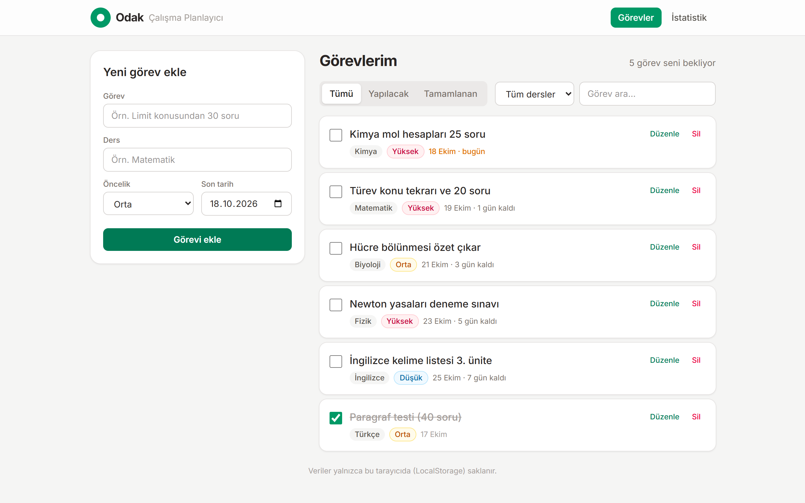
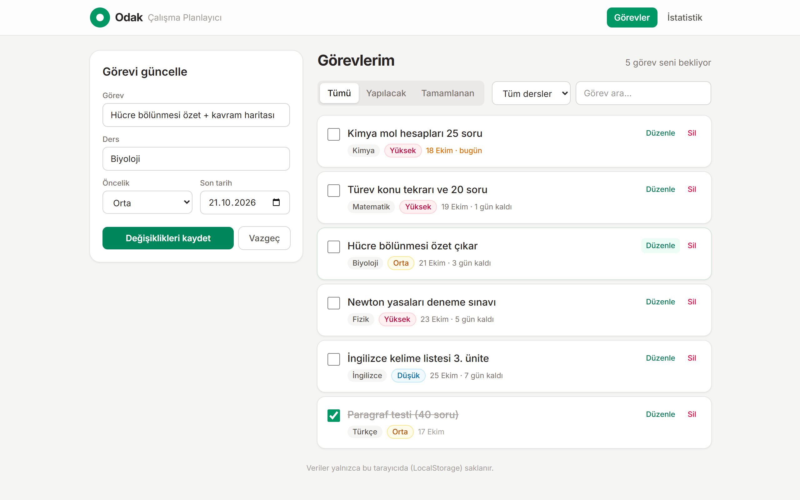
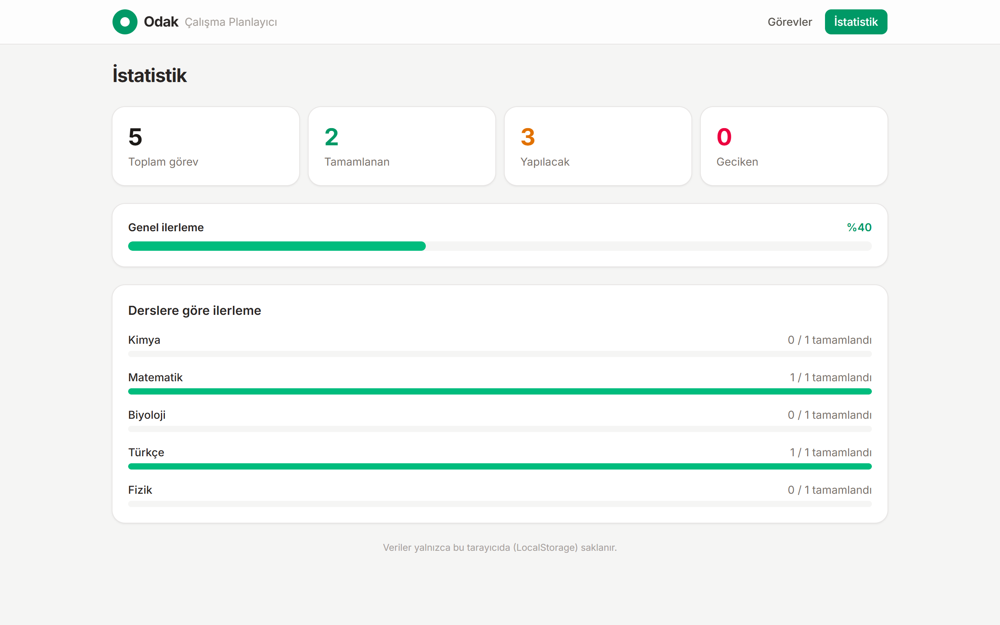
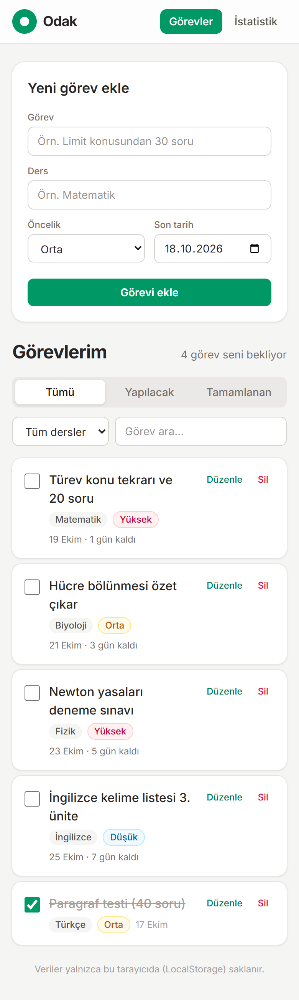

# Odak — Çalışma Planlayıcı

Ders çalışma görevlerini takip etmek için geliştirilmiş bir React uygulaması. Görev ekleyebilir, listeleyip filtreleyebilir, düzenleyebilir, tamamlandı olarak işaretleyebilir ve silebilirsiniz. Veriler tarayıcının **LocalStorage**'ında saklanır.

**Canlı demo:** https://odak-planlayici.netlify.app



## Özellikler (CRUD)

| İşlem | Nasıl? |
|---|---|
| **Ekle** | Soldaki formdan görev, ders, öncelik ve son tarih girilir. Boş/kısa başlık engellenir. |
| **Listele** | Görevler yapılacaklar önde olacak şekilde son tarihe ve önceliğe göre sıralanır; duruma, derse ve metne göre filtrelenebilir. |
| **Güncelle** | “Düzenle” formu düzenleme moduna alır; kutucuk ile görev tamamlandı olarak işaretlenir. |
| **Sil** | “Sil” önce onay ister, ardından görevi kaldırır. |

Ek olarak **İstatistik** sayfası toplam / tamamlanan / geciken görevleri ve ders bazında ilerlemeyi gösterir.

## Teknolojiler

- **React 19** + **TypeScript** (Vite ile)
- **Tailwind CSS 4**
- **React Router 7** (iki sayfa: Görevler, İstatistik)
- **LocalStorage** ile kalıcı veri
- **Netlify** ile yayın (`public/_redirects` SPA yönlendirmesi için)

## Klasör yapısı

```
src/
├── components/   # GorevFormu, GorevKarti, FiltreCubugu, Navbar
├── pages/        # GorevlerSayfasi, IstatistikSayfasi
├── interfaces/   # Gorev tipi ve ilgili tanımlar
├── hooks/        # useGorevler — LocalStorage tabanlı CRUD
└── utils/        # tarih yardımcıları
```

## Çalıştırma

```bash
npm install
npm run dev      # geliştirme sunucusu
npm run build    # dist/ klasörüne üretim derlemesi
```

## Ekran görüntüleri

| Görev düzenleme | İstatistik |
|---|---|
|  |  |


